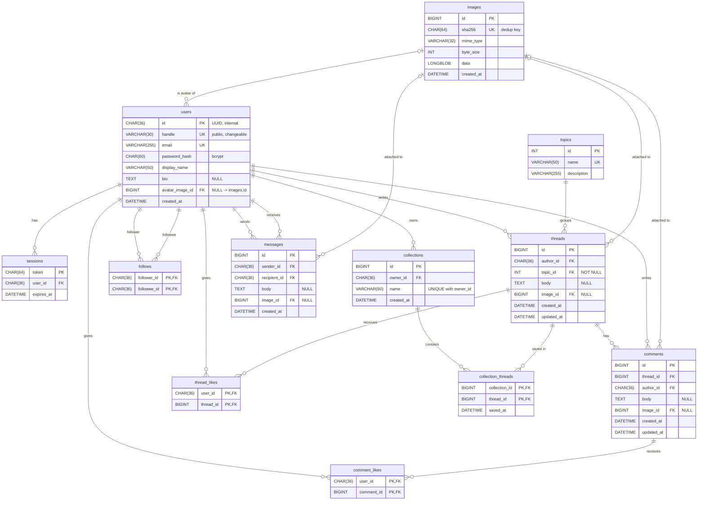

# ER diagram

All 12 tables in `db/schema.sql`. GitHub, VS Code (with a Mermaid extension) and <https://mermaid.live> render the diagram below.

Notation: `||` exactly one, `|o` zero or one, `o{` zero or more.

## Relationships

### One-to-many (1–N)

| Parent → child | Meaning | ON DELETE |
|---|---|---|
| users → sessions | One user can be logged in on many browsers; each session belongs to one user. | CASCADE: deleting a user logs them out everywhere. |
| users → threads (`author_id`) | A user writes many threads; each thread has exactly one author. | CASCADE |
| topics → threads (`topic_id`, NOT NULL) | A topic groups many threads; each thread is in exactly one topic, chosen when it is created. | RESTRICT: a topic that still has threads cannot be deleted. |
| threads → comments | A thread has many comments; each comment belongs to one thread. | CASCADE: deleting a thread deletes its comments. |
| users → comments (`author_id`) | A user writes many comments. | CASCADE |
| users → collections (`owner_id`) | A user owns many collections. Names are unique per owner: `UNIQUE(owner_id, name)`. | CASCADE |
| users → messages (`sender_id`, `recipient_id`) | Two separate 1–N relationships: a user sends many messages and receives many messages. A conversation is the set of rows between two users, in either direction. | CASCADE on both: a deleted user's conversations disappear. |
| images → users / threads / comments / messages | An image row can be referenced by many rows: uploads are deduplicated by SHA-256, so identical files share one row. Each referencing row has zero or one image (the column is nullable). | Avatar: SET NULL. Threads, comments, messages: RESTRICT. |

The content tables have `CHECK (body IS NOT NULL OR image_id IS NOT NULL)`. MySQL does not allow `ON DELETE SET NULL` on a column used in a CHECK (error 3823), and SET NULL could break the rule anyway. The app never deletes image rows, so RESTRICT is the right choice.

### Many-to-many (M–N) through junction tables

| Junction table | Connects | Composite primary key | Notes |
|---|---|---|---|
| `thread_likes` | users ↔ threads | (user_id, thread_id) | A user likes many threads, and a thread is liked by many users. The PK stops anyone liking a thread twice, which is what makes the `INSERT IGNORE` toggle work. |
| `comment_likes` | users ↔ comments | (user_id, comment_id) | Same as above, for comments. |
| `follows` | users ↔ users (self-referencing) | (follower_id, followee_id) | A user follows many users and is followed by many. `CHECK (follower_id <> followee_id)` blocks following yourself. Follower and following counts are `COUNT(*)` queries, never stored. |
| `collection_threads` | collections ↔ threads | (collection_id, thread_id) | A collection holds many threads, and a thread can be saved in many collections. It has one extra attribute, `saved_at`. |

Every junction table cascades from both sides: a like, follow or saved entry disappears with either of the rows it connects. Each table has a second index that starts with the other column (for example `thread_likes(thread_id)`), so lookups from either side, such as counting the likes on a thread, use an index.

### Identity: `id` vs `handle`

`users.id` is a UUID that never changes, and every foreign key points to it. `handle` is the public name used in URLs (`/u/alice`) and can be edited. Renaming a handle is a single-row UPDATE: no foreign key changes, and old threads still belong to the same user.
