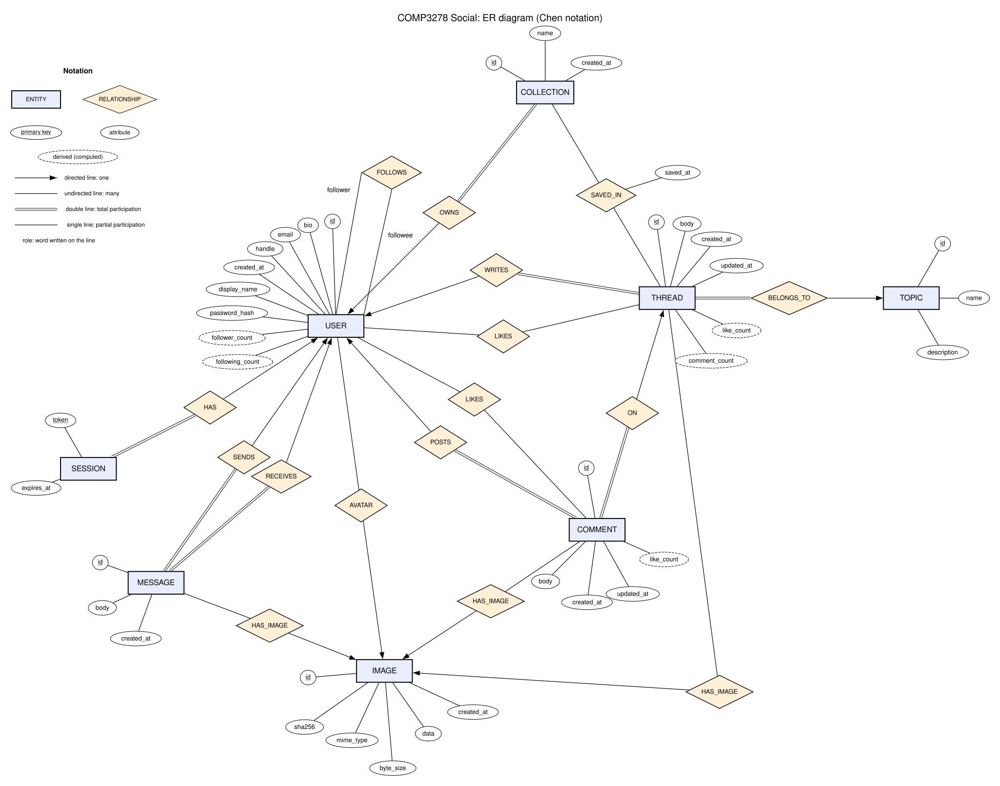

# ER diagram (Chen notation)

| File | What it is |
|---|---|
| [`er-diagram.svg`](er-diagram.svg) | The diagram (vector; scales to any size). |
| [`er-diagram.png`](er-diagram.png) | The same diagram as a PNG, for slides. |
| [`er-diagram.dot`](er-diagram.dot) | Graphviz source. Regenerate with `dot -Kneato -Tsvg docs/er-diagram.dot -o docs/er-diagram.svg`, or paste it into <https://dreampuf.github.io/GraphvizOnline> with engine **neato**. |

## Notation

Use the notation in `ch2 - ER-model.pdf`, especially pages 34, 49, 59, and 70:
rectangles, relationship diamonds, attribute ellipses, underlined primary keys,
arrows toward the one side, double lines for total participation, and named roles.
Do not replace it with crow's-foot or UML notation.

| Symbol | Meaning |
|---|---|
| Rectangle | **Entity set** |
| Diamond | **Relationship set** |
| Ellipse | **Attribute**; an <u>underlined</u> name is the primary key |
| Dashed ellipse | **Derived attribute**: computed by a query every time, not stored (for example `follower_count` is a `COUNT(*)` over `follows`) |
| Directed line (arrow from the diamond to an entity) | **Mapping cardinality "one"**: each entity on the other side relates to at most one entity of that set |
| Undirected line | **Mapping cardinality "many"**. Plain lines on both sides make a many-to-many relationship. |
| Double line | **Total participation**: every entity on that side must take part in the relationship. In the schema this is a `NOT NULL` foreign key. |
| Single line | **Partial participation**: taking part is optional |
| Word on a line | **Role** name, used on the recursive FOLLOWS (`follower`, `followee`) |

How to read an arrow: WRITES has an arrow to USER and a plain double line to THREAD. So each thread is written by **one** user, a user can write **many** threads, and every thread must have a writer (total participation).

The model has no weak entity sets: every entity has its own primary key. It also has no multi-valued attributes and no ISA specialization.

Foreign-key columns (`author_id`, `topic_id`, `owner_id`, …) are not drawn as attributes. In Chen notation the relationship diamonds stand for them, and the [mapping to tables](#from-the-er-diagram-to-the-tables) below shows where each one ends up.

## Entity sets

| Entity | Primary key | Attributes | Derived attributes |
|---|---|---|---|
| USER | `id` (UUID) | handle, email, password_hash, display_name, bio, created_at | follower_count, following_count |
| SESSION | `token` | expires_at | |
| TOPIC | `id` | name, description | |
| THREAD | `id` | body, created_at, updated_at | like_count, comment_count |
| COMMENT | `id` | body, created_at, updated_at | like_count |
| COLLECTION | `id` | name, created_at | |
| MESSAGE | `id` | body, created_at | |
| IMAGE | `id` | sha256, mime_type, byte_size, data, created_at | |

`SESSION.expires_at` supports daily-throttled sliding expiry: the previous renewal
time is derived as `expires_at - 30 days`, so no extra stored attribute is needed.

`handle`, `email` and `sha256` are candidate keys: they have UNIQUE constraints but are not the primary key. `handle` is kept separate from `id` so it can change without touching any foreign key.

## Relationship sets

| Relationship | Between | Mapping cardinality | Arrow points to | Participation | Meaning |
|---|---|---|---|---|---|
| HAS_SESSION | USER – SESSION | one-to-many | USER | SESSION total | A user can be logged in on many browsers; every session belongs to one user. |
| WRITES | USER – THREAD | one-to-many | USER | THREAD total | Every thread has exactly one author. |
| BELONGS_TO | TOPIC – THREAD | one-to-many | TOPIC | THREAD total | Every thread is in exactly one topic, chosen when it is created. |
| COMMENT_ON | THREAD – COMMENT | one-to-many | THREAD | COMMENT total | Every comment is on exactly one thread. |
| POSTS | USER – COMMENT | one-to-many | USER | COMMENT total | Every comment has exactly one author. |
| OWNS | USER – COLLECTION | one-to-many | USER | COLLECTION total | Every collection has one owner. |
| SENDS | USER – MESSAGE | one-to-many | USER | MESSAGE total | Every message has one sender… |
| RECEIVES | USER – MESSAGE | one-to-many | USER | MESSAGE total | …and one recipient. Two separate relationships between the same pair of entity sets. |
| LIKES_THREAD | USER – THREAD | many-to-many | (none) | both partial | A user likes many threads; a thread is liked by many users. |
| LIKES_COMMENT | USER – COMMENT | many-to-many | (none) | both partial | The same, for comments. |
| FOLLOWS | USER – USER | many-to-many | (none) | both partial | **Recursive** relationship with two roles written on its lines: *follower* and *followee*. |
| SAVED_IN | COLLECTION – THREAD | many-to-many | (none) | both partial | A collection holds many threads, and a thread can be in many collections. Has its own attribute, **saved_at**. |
| AVATAR | IMAGE – USER | one-to-many | IMAGE | both partial | A user has at most one avatar. Because uploads are deduplicated, one image can be the avatar of many users. |
| THREAD_IMAGE | IMAGE – THREAD | one-to-many | IMAGE | both partial | A thread has at most one image; one image can be shared by many threads. |
| COMMENT_IMAGE | IMAGE – COMMENT | one-to-many | IMAGE | both partial | The same, for comments. |
| MESSAGE_IMAGE | IMAGE – MESSAGE | one-to-many | IMAGE | both partial | The same, for messages. |

## From the ER diagram to the tables

Every relationship set has a unique name, and that name carries over to its table or foreign key. The full relational schema, the functional dependencies and the BCNF check are in [relational-schema.md](relational-schema.md).

The schema in [`db/schema.sql`](../db/schema.sql) follows the standard ER-to-relational mapping:

1. **Each entity set becomes a table** with its simple attributes as columns and its key as the primary key: `users`, `sessions`, `topics`, `threads`, `comments`, `collections`, `messages`, `images`.
2. **Each one-to-many relationship becomes a foreign key on the "many" side**, which is the side without the arrow. The key points at the entity the arrow points to. No extra table is needed:

   | Relationship | Foreign key column | NULL? |
   |---|---|---|
   | HAS_SESSION | `sessions.user_id → users.id` | NOT NULL (total) |
   | WRITES | `threads.author_id → users.id` | NOT NULL (total) |
   | BELONGS_TO | `threads.topic_id → topics.id` | NOT NULL (total) |
   | COMMENT_ON | `comments.thread_id → threads.id` | NOT NULL (total) |
   | POSTS | `comments.author_id → users.id` | NOT NULL (total) |
   | OWNS | `collections.owner_id → users.id` | NOT NULL (total) |
   | SENDS | `messages.sender_id → users.id` | NOT NULL (total) |
   | RECEIVES | `messages.recipient_id → users.id` | NOT NULL (total) |
   | AVATAR | `users.avatar_image_id → images.id` | NULL allowed (partial) |
   | THREAD_IMAGE, COMMENT_IMAGE, MESSAGE_IMAGE | `threads.image_id`, `comments.image_id`, `messages.image_id → images.id` | NULL allowed (partial) |

   This is where the double lines show up in the schema: total participation means the foreign key is `NOT NULL`.
3. **Each many-to-many relationship (no arrows) becomes its own junction table.** The table holds the two foreign keys, which together form a composite primary key, plus any attributes of the relationship:

   | Relationship | Junction table | Composite primary key | Extra column |
   |---|---|---|---|
   | LIKES_THREAD | `thread_likes` | (user_id, thread_id) | |
   | LIKES_COMMENT | `comment_likes` | (user_id, comment_id) | |
   | FOLLOWS | `follows` | (follower_id, followee_id), named after the two roles | |
   | SAVED_IN | `collection_threads` | (collection_id, thread_id) | `saved_at` |

   The composite key enforces the "at most one" rule for each pair: a user can't like the same thread twice, and that is what makes the `INSERT IGNORE` like toggle work ([key-sql.md §4](key-sql.md#4-like-toggle-insert-ignore-then-delete)).
4. **Derived attributes are not columns.** `follower_count`, `following_count`, `like_count` and `comment_count` are `COUNT(*)` subqueries ([key-sql.md §1 and §3](key-sql.md)), so they can never drift out of sync with the data.

### Constraints the diagram cannot show

Chen notation has no symbol for these rules, so they are enforced by CHECK and UNIQUE constraints in `db/schema.sql`. The full list is in [relational-schema.md §3](relational-schema.md#3-integrity-constraints).

- **THREAD, COMMENT and MESSAGE need non-blank text, an image, or both.**
- **No following yourself, and no messaging yourself.**
- **`updated_at` can never be earlier than `created_at`.**
- **Collection names are unique per owner** (`UNIQUE (owner_id, name)`) and cannot be blank. The same goes for display names and topic names.
- **Handles must be 3–30 letters, digits or underscores, and emails must look like `x@y.z`.** Handle and email are unique, ignoring case.
- **An image's stored `byte_size` must equal `LENGTH(data)`.**
- **Delete behaviour:**
  - Deleting a user cascades to everything that depends on them.
  - A topic that still has threads cannot be deleted (RESTRICT).
  - An image that is still referenced cannot be deleted (RESTRICT).
